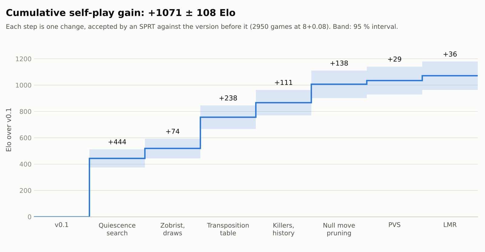

# trzekar-engine

[](https://github.com/trzekar/chess-engine/actions/workflows/ci.yml)

A UCI chess engine written from scratch in C++20, with every search feature measured by SPRT self-play.

- **~2277 ± 29 Elo** vs. Stockfish 19 limited with `UCI_Elo`, at 8+0.08: 500 games against levels 2000–2400 ([`results/gauntlet.csv`](results/gauntlet.csv))
- **37.6 M nodes/s** in perft(6) from the start position ([`results/perft.csv`](results/perft.csv))
- **2.8 M nodes/s** in search, `engine bench` at depth 5 ([`results/bench.csv`](results/bench.csv))

Measured on one thread of an AMD Ryzen 7 4700U, built with `-O3 -march=native`.

## Strength progression

<picture>
  <source media="(prefers-color-scheme: dark)" srcset="docs/img/elo_progress-dark.png">
  
</picture>

Every feature went in as its own tagged version and had to pass a match against the previous
one before I merged it.

| Version | Technique | Elo vs. previous | Games | Test | Cumulative |
|---|---|---:|---:|---|---:|
| `v0.1` | Baseline: alpha-beta, PeSTO evaluation, iterative deepening | — | — | — | 0 |
| `v0.2-qsearch` | Quiescence search, MVV-LVA ordering | +443.8 ± 69.0 | 208 | SPRT [0, 10] | +444 ± 69 |
| `v0.3-zobrist` | Zobrist hashing, repetition and fifty-move draws | +74.3 ± 28.0 | 228 | SPRT [−10, 0] | +518 ± 74 |
| `v0.4-tt` | Transposition table | +237.9 ± 50.3 | 222 | SPRT [0, 10] | +756 ± 90 |
| `v0.5-ordering` | Killer moves, history heuristic | +111.2 ± 36.1 | 310 | SPRT [0, 10] | +867 ± 97 |
| `v0.6-nmp` | Null move pruning, R = 2 | +138.5 ± 40.7 | 264 | SPRT [0, 10] | +1006 ± 105 |
| `v0.7-pvs` | Principal variation search | +29.0 ± 17.6 | 914 | SPRT [0, 10] | +1035 ± 107 |
| `v0.8-lmr` = `v1.0` | Late move reductions, 1 ply | +36.4 ± 20.1 | 804 | SPRT [0, 10] | +1071 ± 108 |

Matches run in [fastchess](https://github.com/Disservin/fastchess) at 8+0.08, with
[UHO openings](https://github.com/official-stockfish/books) played from both sides. Each one is
an SPRT with elo0 = 0, elo1 = 10 and α = β = 0.05, so it stops as soon as there is enough
evidence either way. Big gains were settled in about 200 games; PVS needed 914. Errors are 95%
intervals. Before trusting any of it, I played `v0.1` against itself: −8.7 ± 23.3 Elo in 200
games, so the setup reads noise as noise.

`v0.3` bundled two things: Zobrist hashing, which is only groundwork for the transposition
table, and draw detection, which changes how the engine plays. I expected the draws to gain
something, but tested the version only for no regression, because most of the code was the
hashing. It came out at +74: `v0.2` could not see a repetition, so it would happily walk into
a threefold repetition while winning. Looking back, those should have been two separate
measurements.

Take the +1071 with a grain of salt. Self-play inflates the gap between versions of the same
engine, and an SPRT that stops early overestimates the gain. For a number on an outside scale,
see the Stockfish gauntlet above.

`v1.0` is the same commit as `v0.8-lmr`. A time management tweak I tried after it gained
nothing, so it never went in.

## Build and run

You need CMake 3.20 or newer and a C++20 compiler, GCC or Clang. Python 3 is only needed for
the scripts.

```sh
cmake -S . -B build/release -DCMAKE_BUILD_TYPE=Release
cmake --build build/release --parallel
./build/release/engine
```

On Windows with MinGW, add `-G "MinGW Makefiles"` to the first command. The build uses
`-march=native`, so the binary is tuned to your CPU; pass `-DNATIVE=OFF` for one that runs
anywhere.

Without arguments the engine speaks UCI, so you can load it into any chess GUI
(I used [Cute Chess](https://github.com/cutechess/cutechess)) or type to it directly:

```text
uci
position startpos moves e2e4
go movetime 1000
```

## Reproducing the measurements

Every measurement in this README comes from a command below and is recorded in `results/`.

```sh
ctest --test-dir build/release --output-on-failure            # unit tests, fast perft suite
./build/release/test_perft tests/perft_positions.epd --deep   # perft up to 200M nodes per position
./build/release/engine perft 6                                # 119060324 nodes, and the speed
./build/release/engine bench                                  # 764446 nodes at v1.0
```

The bench searches 20 fixed positions to depth 5. Its node count is the same on every machine,
so it works as a fingerprint of the search: each commit that changes it ends with a
`Bench: <nodes>` line.

The matches need [fastchess](https://github.com/Disservin/fastchess), an opening book from
[official-stockfish/books](https://github.com/official-stockfish/books) and, for the gauntlet,
Stockfish. Their paths go into `match.local.json` in the repository root:

```json
{"fastchess": "path/to/fastchess", "book": "path/to/UHO_Lichess_4852_v1.epd",
 "concurrency": 7, "stockfish": "path/to/stockfish"}
```

Set `concurrency` to the number of physical cores minus one, and on Windows with MinGW add
`"cmake_generator": "MinGW Makefiles"`. Then:

```sh
python3 scripts/match.py v0.8-lmr v0.7-pvs                # SPRT of one version against another
python3 scripts/gauntlet.py v1.0 --levels 2200 2400       # Elo against rating-limited Stockfish
pip install -r requirements.txt
python3 scripts/plot_elo.py                               # redraws the chart above
```

`match.py` and `gauntlet.py` build each version from its git tag, so every row in
`results/` can be played again.

## Architecture

About 2,700 lines of C++ in `src/`, standard library only.

```text
types.h, bitboard.h    squares, pieces, 16-bit moves, bit tricks
attacks.*              attack tables; sliding pieces by walking the rays
position.*             board, FEN, make_move (copy-make)
zobrist.h              hash keys, generated at compile time
movegen.*              pseudo-legal moves, captures only for quiescence
perft.*                perft and divide, the oracle for movegen and make_move
eval.*                 PeSTO tapered evaluation
search.*               iterative deepening, PVS, quiescence, null move, LMR, move ordering
tt.*                   transposition table
timeman.h              time budget per move
uci.*                  UCI protocol, search thread
bench.*, main.cpp      bench positions; command line (perft, divide, search, bench)
```

`uci.cpp` reads commands and starts `think` on a second thread. `think` deepens one ply at a
time; the search generates moves, plays each on a copy of the position, probes the
transposition table and ends every line in quiescence search with `eval`. Each finished depth
goes back to the GUI as an `info` line, and all output passes through one mutex, so the two
threads never mix their lines.

Outside `src/`: `tests/` holds one test program per module, `scripts/` the Python tooling,
`results/` every measurement as CSV and `deploy/` the Lichess bot setup.

## Design decisions

**Bitboards.** A position is twelve 64-bit bitboards, one per piece type and colour, plus a
piece-per-square table. Knight, king and pawn attacks are table lookups. Rook, bishop and
queen attacks walk each ray up to the first blocker, which is easy to check against a naive
8×8 reference, as `test_attacks` does. The price is a loop for every sliding piece; perft
still runs at 37.6 M nodes/s.

**Copy-make instead of unmake.** Before each move the search copies the 200-byte position and
plays the move on the copy; going back means dropping the copy. With no unmake there is no way
to restore castling rights, the en passant square or the hash incorrectly, a class of bugs that
perft would otherwise have to catch. The cost is a 200-byte copy at every node. Moves are
generated pseudo-legal, and `make_move` returns false when a move leaves the king in check, so
each illegal move also costs a copy.

**An always-replace transposition table.** Entries are 16 bytes (the full key, move, score,
depth and bound), so the default 16 MB holds about a million of them, indexed by the low bits
of the hash. A new entry always overwrites the one at its index. It is the simplest scheme and
needs no aging between moves; the cost is that a shallow entry can push out a deep one that
took far more work to compute.

**The search on its own thread.** The engine has to answer `isready` and `stop` while it
thinks, so the search runs on a second thread with an atomic stop flag and checks the clock
every 2048 nodes. The search itself never prints: it reports each finished depth through a
callback, and every line goes out through one mutex with a flush. That costs one lock per line
and guarantees that lines from the two threads never mix and that a GUI never waits for a
buffered `bestmove`.

## Credits

- [Chess Programming Wiki](https://www.chessprogramming.org) for nearly every technique here,
  and its [perft results](https://www.chessprogramming.org/Perft_Results) for the move
  generator tests.
- [PeSTO](https://www.chessprogramming.org/PeSTO%27s_Evaluation_Function) by Ronald
  Friederich for the evaluation tables, used as published.
- [Stockfish](https://github.com/official-stockfish/Stockfish) for `go perft` while hunting
  move generation bugs, the bench positions, and the opponent in the gauntlet.
- [fastchess](https://github.com/Disservin/fastchess) for matches and SPRT, the
  [UHO book](https://github.com/official-stockfish/books) for openings, and
  [lichess-bot](https://github.com/lichess-bot-devs/lichess-bot) for the bot.
- [python-chess](https://github.com/niklasf/python-chess) for the expected positions in the
  `make_move` tests.
- Sebastian Lague's *Coding Adventure: Chess* videos, which got me started.

I wrote the engine's core by hand: the search and everything in it, the transposition table,
`make_move`, Zobrist hashing and time management. [Claude Code](https://claude.com/claude-code)
wrote the tooling around it, the build, CI, FEN and UCI parsing, the tests and the Python
scripts, under the rules in [`CLAUDE.md`](CLAUDE.md), and I reviewed every line.

## License

[MIT](LICENSE)
